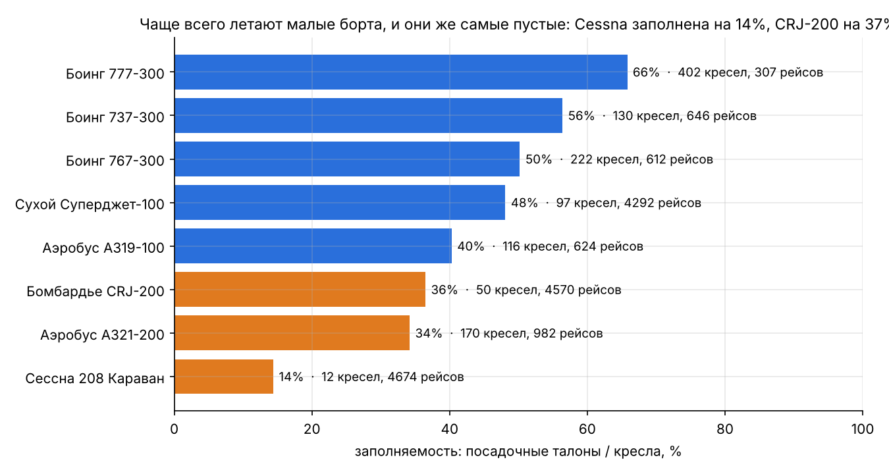
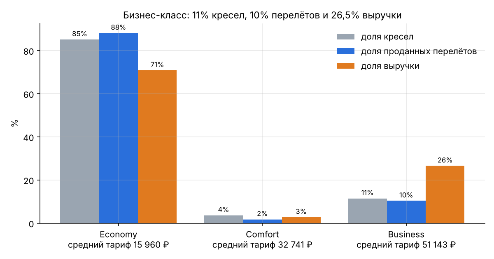
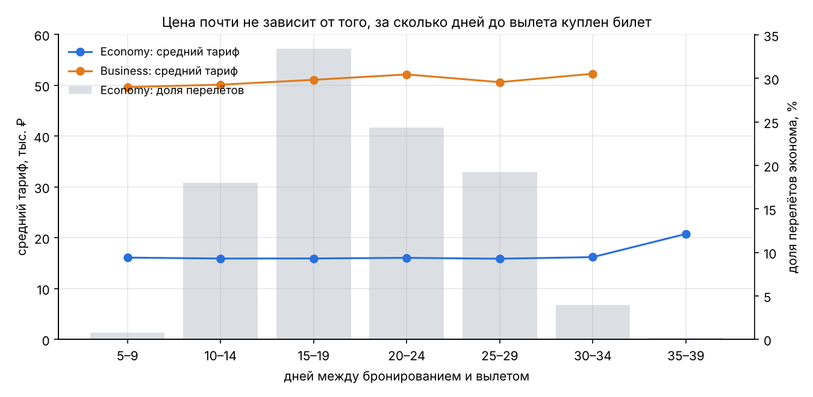
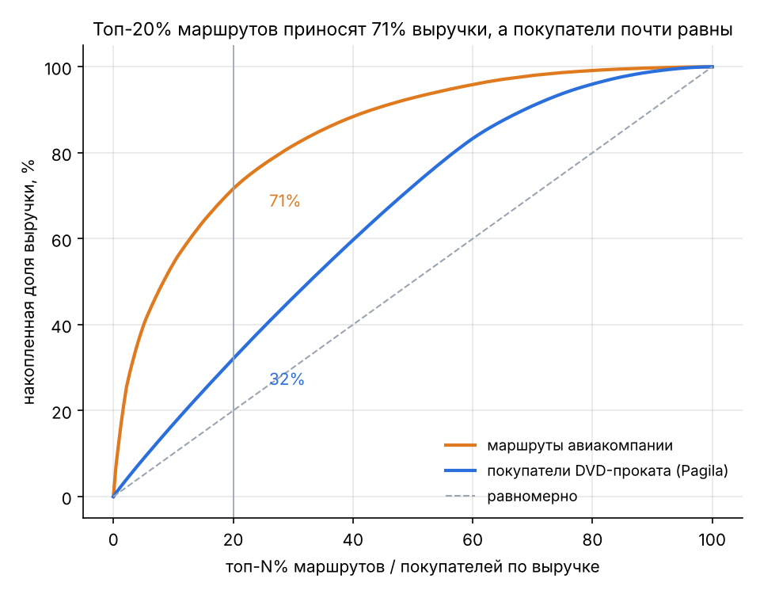

# SQL: PostgreSQL на учебных базах

Мои решения по курсу «Системы управления базами данных» (СПбГЭУ, 7 семестр, 2025). Плюс несколько аналитических запросов
поверх тех же баз: по ним построены графики ниже.
Всё прогоняется в GitHub Actions на настоящих базах: [run-sql.yml](.github/workflows/run-sql.yml) поднимает PostgreSQL 18,
загружает [Pagila](https://github.com/devrimgunduz/pagila) (DVD rental) и демобазу Postgres Pro «Авиаперевозки»,
выполняет каждый файл с `ON_ERROR_STOP` и сохраняет результаты аналитических запросов в [`results/`](results).

## Что где

| Файл | Темы |
|---|---|
| [`dvdrental/01_ddl_constraints.sql`](dvdrental/01_ddl_constraints.sql) | проектирование схемы: справочники, связи M:N, PK/FK, UNIQUE, CHECK, DEFAULT, `unnest` для вставки |
| [`dvdrental/02_filtering_sorting_grouping.sql`](dvdrental/02_filtering_sorting_grouping.sql) | фильтры, `ILIKE`, интервалы, `FILTER`, `GROUPING SETS`, `string_agg` |
| [`dvdrental/03_joins.sql`](dvdrental/03_joins.sql) | inner/left/right/cross join, anti-join |
| [`dvdrental/04_subqueries_explain.sql`](dvdrental/04_subqueries_explain.sql) | подзапросы, коррелированные подзапросы, `NOT IN` против `NOT EXISTS`, `EXPLAIN ANALYZE` |
| [`dvdrental/05_cte_recursive.sql`](dvdrental/05_cte_recursive.sql) | CTE, рекурсивный обход дерева с путём и уровнем, генерация календаря |
| [`dvdrental/06_window_functions.sql`](dvdrental/06_window_functions.sql) | `row_number`/`rank`/`dense_rank`, `lag`/`lead`, `first_value`/`last_value` с рамкой, нарастающие итоги, именованные окна |
| [`dvdrental/07_arrays_json.sql`](dvdrental/07_arrays_json.sql) | массивы (`&&`, `@>`, `ANY`, `unnest`), JSON (`->`, `->>`, проверка типов регуляркой) |
| [`bookings/control_test_1.sql`](bookings/control_test_1.sql) | контрольная 1: anti-join, `EXCEPT`, `UNION ALL`, `array_agg(distinct …)` |
| [`bookings/control_test_2.sql`](bookings/control_test_2.sql) | контрольная 2: MoM через `lag`, JSONB, доли через окно, первый и последний бронирующий на рейсе, нарастающий итог пустых мест |
| [`analysis/`](analysis) | аналитические запросы для графиков ниже |

Пример из контрольной 2: для каждого рейса найти первого и последнего забронировавшего пассажира и разрыв между ними.
Это делается одним проходом: два `row_number` в разные стороны и условная агрегация.

```sql
with ranked as (
    select tf.flight_id, t.passenger_name, b.book_date,
           row_number() over (partition by tf.flight_id order by b.book_date)      as first_n,
           row_number() over (partition by tf.flight_id order by b.book_date desc) as last_n
    from bookings b
    join tickets t         using (book_ref)
    join ticket_flights tf using (ticket_no)
)
select flight_id,
       max(passenger_name) filter (where first_n = 1) as first_passenger,
       max(passenger_name) filter (where last_n = 1)  as last_passenger,
       max(book_date) filter (where last_n = 1) - max(book_date) filter (where first_n = 1) as gap
from ranked
group by flight_id;
```

## Что видно в данных

Запросы лежат в [`analysis/`](analysis), результаты в [`results/`](results), графики строит [`scripts/make_figures.py`](scripts/make_figures.py).
Демобаза «Авиаперевозки» сгенерирована, поэтому выводы — про эти данные, а не про реальную авиакомпанию.
Но пусть данные и синтетические, приёмы те же, что на работе: доли через окно, кривая концентрации, корзины через `width_bucket`.



**Заполняемость.** Считал посадочные талоны на кресла по завершённым рейсам ([запрос](analysis/bookings_load_factor.sql)).
Cessna 208, CRJ-200 и Superjet вместе — около 80% всех рейсов, и у двух из них заполнено меньше 40% мест.
Широкофюзеляжный Boeing 777 летает реже всех, но полнее всех (66%). Если бы это была реальная сеть,
первый вопрос был бы про частоту рейсов на малых бортах, а не про покупку новых больших самолётов.



**Классы.** Бизнес — 11% кресел и 10% проданных перелётов, но 26,5% выручки: средний тариф в 3,2 раза выше эконома
([запрос](analysis/bookings_fare_mix.sql)). Комфорт есть только у Boeing 777, поэтому его вклад почти незаметен.



**Когда покупают.** Почти все билеты куплены за 10–30 дней до вылета. Средний тариф эконома в этом окне стоит на месте,
около 16 тыс. ₽, и не дешевеет при ранней покупке ([запрос](analysis/bookings_lead_time.sql)).
Рост после 35 дней приходится на 2 тыс. перелётов из 920 тыс. Скорее всего, туда попали дальние маршруты, а не «ранняя цена».
Маршрут в этом запросе не фиксирован, и это следующий шаг проверки.



**Концентрация.** 39 маршрутов из 457 дают половину выручки, топ-20% маршрутов — 71%
([запрос](analysis/bookings_route_pareto.sql)). Это дальние рейсы из Москвы и Петербурга в Хабаровск, Новосибирск и Иркутск:
первые строки — DME–KHV и KHV–DME. У покупателей Pagila кривая почти диагональная: топ-20% дают 32% выручки
([запрос](analysis/dvdrental_customer_pareto.sql)). Это синтетика без «китов», и по ней хорошо видно, как выглядит отсутствие концентрации.


## Как запустить у себя

```bash
git clone https://github.com/devrimgunduz/pagila && createdb dvdrental
psql -d dvdrental -f pagila/pagila-schema.sql && psql -d dvdrental -f pagila/pagila-data.sql
psql -d dvdrental -f dvdrental/06_window_functions.sql
```

В Pagila даты сдвинуты относительно классической dvdrental (2022 год вместо 2005-го). Поэтому запросы
с конкретными датами из заданий я переписал на «первый месяц данных» и «самый загруженный день».

---

**EN.** PostgreSQL solutions from my university DBMS course (DVD rental / Pagila and the Postgres Pro airline demo DB):
DDL and constraints, joins, subqueries and `EXPLAIN ANALYZE`, CTEs and recursive queries, window functions, arrays and JSON.
A GitHub Actions workflow loads both databases, runs every file, and stores the analysis query results that feed the charts.
